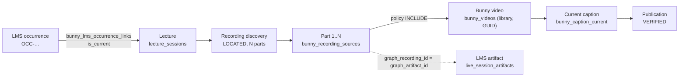

# Lecture recordings for the Kent LMS

*LMS backend handover · read-only audit*

How the Continuous Bunny Publisher's verified lecture recordings should reach the LMS backend: what exists today, the exact database mappings checked against the 7 published lectures, and the integration contract we recommend building.

- **Audited:** 24 Oct 2026, 10:45–11:30 Cairo
- **Sources:** publisher database, LMS database and Bunny library 786045, all read-only
- **Changes made:** none

## Contents

1. [Summary](#summary)
2. [Existing capabilities](#existing-capabilities)
3. [Where the data lives](#where-the-data-lives)
4. [Verified mappings: the 7 published lectures](#verified-mappings-the-7-published-lectures)
5. [Gaps and ambiguities](#gaps-and-ambiguities)
6. [Read-only database view, or authenticated REST API?](#read-only-database-view-or-authenticated-rest-api)
7. [Recommended API contract (v1)](#recommended-api-contract-v1)
8. [Hidden videos, signed playback and permissions](#hidden-videos-signed-playback-and-permissions)
9. [Delivering to a separate production library](#delivering-to-a-separate-production-library)
10. [Who does what](#who-does-what)
11. [Staging-to-production plan](#staging-to-production-plan)
12. [Questions for the LMS backend team](#questions-for-the-lms-backend-team)
13. [Minimal implementation plan](#minimal-implementation-plan)

---

## Summary

- **The mapping is sound.** All 7 published lectures trace cleanly: one LMS occurrence → one lecture → its Teams recording parts → one Bunny video per included part → one verified English caption. No occurrence maps to more than one lecture.
- **The LMS can keep its viewing history.** Every published part matches the LMS's own recording artifact exactly, on Teams recording ID, call ID and content correlation ID.
- **Nothing is exposed to the LMS yet.** The publisher has no LMS-facing API, export view or delivery event. Its operations API is for staff, keyed by lecture rather than occurrence, and includes internal job history.
- **"HIDDEN" is only a database label.** Bunny has no per-video hidden flag, and no code path changes `visibility_state`. On library 786045, player token authentication is off and direct play is on.
- **Production delivery needs work.** `PRODUCTION_WRITE` exists and is gated, but it isn't configured. Moving to production means re-importing from SharePoint, which produces *new* Bunny video IDs, plus a promotion step for lectures that are already ready.
- **Recommendation:** an authenticated, read-only REST API keyed by LMS occurrence ID that computes readiness live, plus a `changed_since` feed. The LMS checks enrolment and signs short-lived Bunny embed tokens. The publisher never decides who may watch.

---

## Existing capabilities

| Capability | Status | Where | Notes |
|---|---|---|---|
| LMS occurrence matching (Teams meeting key + exact UTC start) | ✅ Exists | `app/lms/matching.py` | Rule `meeting_key_start_v2`. One current decision per lecture, with full history. |
| LMS-side coverage (LMS sessions with no lecture) | ✅ Exists | `bunny_lms_occurrence_coverage` | Only covers the discovery window: 16 rows now. |
| Recording parts, located and duration-verified | ✅ Exists | `bunny_recording_sources` | A part is only located if it's proven against the Graph recording. |
| Fragment / multi-part policy, with operator decisions | ✅ Exists | `progress.py`, `bunny_publisher_part_decisions` | Fragments are never dropped or published automatically. |
| Bunny import, encoding verification, caption publish + read-back | ✅ Exists | `bunny_jobs.py` | Staging library 786045 only. |
| Readiness ("fully ready" per library) | ✅ Exists | `progress.readiness()` | Computed in Python, not stored. Recorded once as the event `LECTURE_FULLY_READY`. |
| Staff operations API (status, lecture, exceptions) | ⚠️ Partial | `/operations/publisher/*` | DRF user tokens, keyed by lecture, includes jobs and history. Not an LMS contract. |
| LMS-facing read API / export view | ❌ Missing | — | No endpoint or view keyed by occurrence. |
| Delivery event / webhook to the LMS | ❌ Missing | — | The alert outbox exists, but delivery is disabled. Events are an internal audit log. |
| Release state (`HIDDEN → READY_FOR_LMS → WITHDRAWN`) | ❌ Missing | `bunny_videos.visibility_state` | The column and CHECK exist, but nothing ever writes a value other than `HIDDEN`. |
| Production library delivery | ⚠️ Partial | `app/publisher/config.py` | Mode and gate exist; there's no library, no keys and no promotion path. |
| Signed playback / token-auth library | ❌ Missing | Bunny settings | Token auth is off on 786045. Signing belongs to the LMS. |
| Bunny `metaTags` (lecture / occurrence ID on the video) | ⚠️ Partial | `BunnyStreamClient.set_meta_tags` | Only the old pilot uses it. The occurrence ID is in the video title. |

---

## Where the data lives

Publisher database: AiTeamKBC on Neon, migrations 024–028. The LMS database is separate and is only ever read. LMS IDs are stored as text, with no foreign keys across the two databases.

| Fact | Table · columns | Rule |
|---|---|---|
| Lecture | `lecture_sessions` · `lecture_id`, `subject`, `module`, `session_date`, `scheduled_start`, `scheduled_end`, `is_cancelled`, `metadata→duplicate_suppression` | Times are UTC `timestamptz`. Never expose `join_url`, `meeting_id` or `calendar_event_id`. |
| LMS match decision | `bunny_lms_match_evaluations` · `match_status`, `requires_review`, `rule_version`, `is_current`, `meeting_key_hash` | Exactly one row per lecture has `is_current` set. Only `VERIFIED` has links. |
| LMS occurrence / session ID | `bunny_lms_occurrence_links` · `lms_occurrence_id`, `lms_live_session_id`, `lms_module_catalogue_id`, `lms_session_number`, `link_role` | Unique index: one current lecture per occurrence. Role `PRIMARY`, or `SHARED_MODULE` (none in use yet). |
| Teams meeting | `lecture_sessions.meeting_id` · `bunny_lms_match_evaluations.meeting_key_hash` | Internal. The match uses a 16-hex hash of the meeting key. |
| Recording coverage | `bunny_recording_discoveries` · `status`, `expected_part_count`, `located_part_count`, `missing_part_count` | `LOCATED` means every part was found (enforced by a CHECK). |
| Recording parts | `bunny_recording_sources` · `recording_part_index`, `graph_recording_id`, `call_id`, `content_correlation_id`, `classification`, `locate_status`, `source_duration_seconds`, `recording_created_at` | Part order follows Teams recording order. Each recording and each file belongs to one lecture. |
| Part decision | `bunny_publisher_part_decisions` · `decision`, `reason`, `actor`, `decided_at` | `INCLUDE` / `EXCLUDE`, audited. |
| Bunny video | `bunny_videos` · `bunny_library_id`, `bunny_video_id`, `recording_part_index`, `import_status`, `encoding_status`, `bunny_length_seconds`, `bunny_width/height`, `available_resolutions`, `visibility_state`, `retired_at` | The live row has `retired_at IS NULL`. Unique per (library, lecture, part). |
| Caption | `bunny_caption_current` → `bunny_caption_publications` · `language_code`, `caption_label`, `publication_status`, `published_cue_count`, `bunny_caption_version`, `verified_at` | `bunny_caption_current` points to one publication per (library, video, language). Older publications are kept as history. |
| Readiness | `app/publisher/progress.py` · `readiness()` · `bunny_publisher_events` (`LECTURE_FULLY_READY`) | Computed. The event is written once and never withdrawn, so it is **not** a source of truth. |
| Existing views | `bunny_lms_match_status_v` · `bunny_publisher_lecture_coverage_v` · `bunny_recording_coverage_v` · `bunny_recording_part_sources_v` · `bunny_publisher_exceptions_v` | |



---

## Verified mappings: the 7 published lectures

All are from 23 Oct 2026.

- **LMS status:** every occurrence is `completed` and every series is `active`.
- **Matches:** every match is `VERIFIED` with exactly 1 candidate, never superseded, and re-confirmed 269 times.
- **Videos:** every video is 1920×1080 (480p/720p/1080p), encoding `VERIFIED`, `HIDDEN`, in library 786045. The Bunny length matches the source file to the second.

Bunny GUIDs are shortened here because, while token authentication is off, a full GUID is close to an access key.

| LMS occurrence | Session | Module · programme | Lecture | Parts (Teams → published) | Bunny video | Length | Caption lines | LMS artifact |
|---|---|---|---|---|---|---:|---:|---|
| `OCC-4493AC65DF5041459BC5A14DA8B357A0` | `LIVE-50B3F91A…` #3 | Social Media · Marketing Executive L4 | `0fe6c2fa` | 1 → 1 | `a1a8fc1d…` | 2:03:57 | 672 | ✅ exact · 1 learner view |
| `OCC-188B392FF4ED45A9B46C02E40072A1F9` | `LIVE-781D67E8…` #3 | Commercial Intelligence · Marketing Manager L6 | `15e61dca` | 1 → 1 | `550c9c30…` | 2:13:12 | 649 | ✅ exact |
| `OCC-774CB73AB0094A03A13F87E30B9FF4C0` | `LIVE-BC8E097D…` #3 | AI In Marketing · Marketing Manager L6 | `3f09b150` | 2 → 1 (part 1: 71 s fragment, excluded by operator) | `456d51cf…` (source part 2) | 2:07:33 | 657 | ✅ exact to part 2; no LMS artifact for part 1 |
| `OCC-EB064C5DE7B44E119E67F128896C592B` | `LIVE-9D1E682B…` #3 | Marketing Strategy & Planning · Marketing Manager L6 | `95a710b0` | 1 → 1 | `010900eb…` | 2:09:47 | 656 | ✅ exact |
| `OCC-5FDA481E5B1145398AA108E04D19F9A4` | `LIVE-71DA0E41…` #8 | Ray – MSP Jan 2026 · Project Controls Professional L6 (`linked-external`) | `a7c5fb2a` | 1 → 1 | `51920222…` | 2:09:52 | 726 | ✅ exact |
| `OCC-075C8136DD8546FD834CC6B0E4B7DE18` | `LIVE-CCA51A0A…` #5 | Risk Management · Project Controls Professional L6 | `b4761fb4` | 1 → 1 | `069df826…` | 2:08:24 | 503 | ✅ exact |
| `OCC-B8C49F1C2ED4429786178B5914ED7368` | `LIVE-63A05005…` #5 | Martech – Fri · Marketing Executive L4 | `d2768b20` | 1 → 1 | `04fe964d…` | 1:37:36 | 614 | ✅ exact |

**Integrity checks across the whole schema:**

- 0 occurrences linked to more than one current lecture.
- 0 disagreements between LMS coverage and the links.
- 0 live videos without a current caption.
- 7 `PRIMARY` links and 0 `SHARED_MODULE` links.
- Current LMS match states: `VERIFIED` 7, `TEST_EXCLUDED` 3, `NO_LMS_SESSION` 1, `LI_DUPLICATE` 1.

**Join to LMS artifacts:** for each published part, `bunny_recording_sources.graph_recording_id = curriculum.live_session_artifacts.graph_artifact_id`, and `call_id` and `content_correlation_id` also match. The recording start times differ by 0.0 s. None of these LMS artifacts are stored in the LMS's blob storage, and all have `lmsHiddenFromLearners = false`.

---

## Gaps and ambiguities

| Finding | Impact | Handling |
|---|---|---|
| **Part index ≠ playback position.** AI In Marketing's only published video is Teams part 2. | An LMS that shows "part 2 of 2" would show a gap. | The API returns `sequence` (1..N over published parts) and `source_part_index` separately. |
| **The readiness event is never withdrawn.** `LECTURE_FULLY_READY` is written once. | A later STALE match or replaced caption would not show up there. | The API must compute readiness live from `progress.readiness()`. |
| **`visibility_state` is never set.** All 7 are `HIDDEN` and no code path changes it. | There's no "released to learners" state anywhere. | Add an audited release/withdraw step for the production library only. |
| **Shared modules have never been seen in practice.** `SHARED_MODULE` links are supported but 0 exist. | One lecture may serve several occurrences (cohorts). | The API looks up an occurrence through any current link. Test this before go-live. |
| **Lectures that can't be matched** (`NO_LMS_SESSION`, e.g. AI in Project Control on 23 Oct) are recorded but never imported. | The LMS will never see them. | This is the intended policy (hold until verified). The business needs to confirm it. |
| **LMS sessions with no lecture** (`LMS_ONLY_PENDING` `OCC-C3535F99…`) | The LMS asks about an occurrence that has no recording. | The API answers `200` with state `NOT_DISCOVERED`, not `404`. |
| **The LMS already runs its own Teams recording sync** (1 recording artifact per occurrence; learners already watch). | Two playback sources for the same lecture. | The owner must decide which one is the playback source (question 1). |
| **LMS coverage only spans the discovery window** (3-day lookback). | Older occurrences aren't in `bunny_lms_occurrence_coverage`. | The API reads `bunny_lms_occurrence_links` (permanent), not coverage. |

---

## Read-only database view, or authenticated REST API?

| Criterion | Read-only view for the LMS | Authenticated REST API |
|---|---|---|
| Readiness correctness | ❌ **Weak.** Readiness is Python logic (duplicate rule, fragment policy, per-library caption check). A view would copy it and drift. | ✅ **Strong.** Calls the one definition, `progress.readiness()`. |
| Credentials and blast radius | ❌ **High.** The LMS gets a role on the Lecture Intelligence database: a new Neon role, network path and grants, plus visibility of internal tables. | ✅ **Low.** One read-only service token that can be rotated. No database access. |
| Data minimisation | ⚠️ **Grant-dependent.** Easy to leak join URLs, drive/item IDs or file names through a later view change. | ✅ **Explicit.** Only fields listed in the contract leave the service. |
| Schema coupling | ❌ **Tight.** The LMS breaks on any change to `bunny_*` tables. | ✅ **Versioned.** `/v1/`; internal changes stay hidden. |
| Audit of access | ⚠️ Database logs only | ✅ Per-request access log |
| Release / withdraw policy | ⚠️ Possible, but has to be implemented in SQL. | ✅ Natural. One place to enforce "staging is never playable". |
| Bulk sync | ✅ Easy | ✅ Easy, with a `changed_since` feed |

**Recommendation: the REST API.** Build it inside the existing Django `backend/`, with a dedicated service token modelled on `SOCIAL_MEDIA_SERVICE_TOKEN`. Underneath, a thin internal query (or a new internal view) can collect candidate lectures. The final readiness answer must still come from `progress.readiness()`.

---

## Recommended API contract (v1)

| Endpoint | Purpose | Responses |
|---|---|---|
| `GET /api/publisher/v1/occurrences/{lms_occurrence_id}/recording` | What recording an occurrence has, and whether it can be played | `200` always for a known occurrence, with a `state`; `404` unknown; `401/403` bad token |
| `GET /api/publisher/v1/occurrences?changed_since=<ISO>&cursor=…` | Incremental feed, so the LMS can cache recordings in its own tables | `200` page of the same objects plus `next_cursor` |
| `GET /api/publisher/v1/health` | Contract version and publication library mode | `200` |

**`state` values:**

- `READY`: playable once the LMS has checked enrolment.
- `PROCESSING`: recording, import, encoding or caption still running.
- `REVIEW_REQUIRED`: waiting for an operator (fragment, ambiguous match, recording review).
- `BLOCKED`: duplicate, or every part excluded.
- `WITHDRAWN`: an operator pulled it.
- `NOT_DISCOVERED`: the LMS has the session, but the publisher has no lecture for it.
- `NOT_APPLICABLE`: cancelled.

`playback.available` is `true` only when the state is `READY`, the library is the production library, and the lecture has been released. A staging library is never playable.

```json
{
  "contract_version": "1",
  "lms_occurrence_id": "OCC-774CB73AB0094A03A13F87E30B9FF4C0",
  "lms_live_session_id": "LIVE-BC8E097D84364A6F9AB59C64E20B06CD",
  "lms_session_number": 3,
  "link_role": "PRIMARY",
  "state": "READY",
  "blocking": [],
  "lecture": {
    "lecture_id": "3f09b150-1bdf-5f4f-82b3-eb8d254cfa8c",
    "title": "AI In Marketing",
    "session_date": "2026-10-23",
    "scheduled_start": "2026-10-23T08:00:00Z",
    "scheduled_end": "2026-10-23T10:00:00Z",
    "lms_match": { "status": "VERIFIED", "rule_version": "meeting_key_start_v2" }
  },
  "recording": {
    "teams_part_count": 2,
    "published_part_count": 1,
    "total_duration_seconds": 7653,
    "parts": [
      {
        "sequence": 1,
        "source_part_index": 2,
        "classification": "FULL",
        "teams_recording_id": "<graph recording id: joins live_session_artifacts.graph_artifact_id>",
        "bunny": { "library_id": 786045, "video_id": "456d51cf-…" },
        "duration_seconds": 7653,
        "resolutions": ["480p", "720p", "1080p"],
        "encoding": "VERIFIED",
        "captions": [ { "language": "en", "label": "English", "status": "VERIFIED", "version": 1 } ]
      }
    ],
    "excluded_parts": [ { "source_part_index": 1, "reason": "OPERATOR_EXCLUDED_FRAGMENT" } ]
  },
  "playback": {
    "available": false,
    "reason": "STAGING_LIBRARY",
    "library_kind": "STAGING",
    "token_authentication_required": true
  },
  "release": { "visibility": "HIDDEN", "released_at": null },
  "updated_at": "2026-10-23T14:53:53Z"
}
```

**Never in a response:**

- Teams join URLs, meeting IDs, calendar event IDs;
- SharePoint drive/item IDs or file names;
- download or CDN URLs;
- Bunny API keys or token keys;
- transcript or caption text;
- job history.

`teams_recording_id` is the one exception. The LMS already stores it as `graph_artifact_id`, and it lets the LMS keep `live_session_recording_views` keyed on its own `artifact_id`. Confirm this with the LMS team.

---

## Hidden videos, signed playback and permissions

> **Today, "HIDDEN" protects nothing at Bunny.** It's a label in our database. Bunny Stream has no per-video hidden flag, so a video can be played by anyone who has its GUID and meets the library's referrer rule.

| Library 786045 setting (read 24 Oct) | Now | Needed before learners |
|---|---|---|
| `PlayerTokenAuthenticationEnabled` | ❌ `false` | `true`: every embed needs a signed, expiring token |
| `AllowDirectPlay` | ❌ `true` | `false` |
| `BlockNoneReferrer` / `AllowedReferrers` | ✅ `true` / 1 entry | LMS learner domains only |
| CDN (pull zone 6840885) token authentication | ⚠️ Not readable here; the pilot fetched a caption file from the CDN without a token | On, so HLS segments and caption files need tokens |
| `EnableDRM` / MP4 fallback | `false` / `false` | DRM optional (business decision); keep MP4 fallback off |
| `KeepOriginalFiles` | `true` | Business decision (storage cost against the ability to re-encode) |
| Encoding tier / AI transcription | Free / off | Unchanged; the publisher checks these at startup |

**Already in place:**

- The database refuses URLs and temporary links (CHECKs on every jsonb column).
- Library 785080 is refused in code.
- Production writes are gated by `PUBLISHER_PRODUCTION_WRITE_ENABLED`, which is off.
- Speaker voice tags are stripped from captions (`teams_vtt_strip_voice_v1`). Spoken words are published unaltered, by decision.
- The staff API uses DRF tokens and read-only transactions.

**Not yet built:**

- A library with token authentication, and CDN token authentication.
- An LMS service token, the API, and an access log.
- Release/withdraw state, and a policy for when a lecture becomes visible.
- Embed-token signing, done by the LMS: `SHA256_HEX(token_key + video_id + expires)`, valid for 5–15 minutes.
- A startup check that refuses a production library with token authentication off.

---

## Delivering to a separate production library

**What exists:**

- `PRODUCTION_WRITE` mode with its own library ID and keys.
- A refusal if the production library equals the staging library.
- Readiness, videos and captions all scoped by `bunny_library_id`.
- A deterministic video record ID that includes the library.

In the production env file, `BUNNY_PRODUCTION_LIBRARY_ID` and both production keys are empty, and `PUBLISHER_PRODUCTION_WRITE_ENABLED=false`.

**Staging GUIDs will not carry over.** Bunny has no cross-library move. A production import is a new URL Fetch from SharePoint, which creates a new GUID, and its caption is republished to that new video. The LMS must never cache a GUID without its library ID.

| Gap | Why it matters | Change needed |
|---|---|---|
| One library per process; job subjects (`lecture:…:part:n`) don't include the library | A staging daemon and a production daemon would claim each other's jobs. | Switch the one service over (recommended), or add the library to subject keys. |
| Planning window is `START_DATE` + 3-day lookback | Lectures that are already ready (the 7 from 23 Oct) would never be re-planned for production. | An audited `promote` command: re-import selected lectures into the production library. |
| Source availability | Re-import needs the SharePoint MP4 to still exist; Teams recordings may expire. | Confirm the tenant's recording retention; promote soon after go-live. |
| The library check only covers encoding and AI settings | A production library could start with token authentication off. | Extend `check_library_settings` for production: token auth on, direct play off. |
| No release state | Production videos would be ready but have no release decision. | A release/withdraw step that writes `visibility_state`, audited. |
| Staging stays populated | Old GUIDs remain playable while token authentication is off. | Turn on token authentication on 786045 as well, or retire it later with explicit approval (no automatic deletion). |

---

## Who does what

| Responsibility | Publisher | LMS backend |
|---|---|---|
| Identity: occurrence ↔ lecture ↔ parts ↔ Bunny video | **Owns** | Consumes; never parses titles |
| Media and caption quality, readiness | **Owns** | Trusts `state` |
| Multi-part: which parts, and in what order | **Owns** (policy + operator decisions) | Presentation: playlist, or one player with chapters |
| Publication policy: release / withdraw | Records and enforces `playback.available` | Decides *when* learners see it (may keep `lmsHiddenFromLearners`) |
| Learner entitlement (enrolment → occurrence, shared cohorts) | Never | **Owns**, checked on every playback |
| Secure playback: signing embed tokens | Never holds learner context | **Owns** (token key in its own secrets) |
| Bunny library security settings | Checks them at startup | Agrees the referrer domains |
| Viewing analytics | — | **Owns** (keyed on `artifact_id` via `teams_recording_id`) |
| Bunny management keys | **Only holder** | Never |

---

## Staging-to-production plan

1. **Contract on staging.** Build the v1 API against 786045. It always returns `playback.available=false` with reason `STAGING_LIBRARY`, so the LMS team can integrate and test the data flow with no learner exposure.
2. **Provision production.** The account owner creates the production library: Free tier, no AI transcription, player token authentication on, direct play off, CDN token authentication on, referrers limited to the LMS domains. Keys go into `publisher.env` only.
3. **Gate checks.** `validate-config --check-library` must report no problems, including the new security checks.
4. **Switch over.** Set `PUBLISHER_MODE=PRODUCTION_WRITE` and the enable flag, then restart the single service. Staging stops receiving imports; nothing in it is deleted.
5. **Promote.** Run the audited `promote` for the lectures that are already ready, starting with the 7 from 23 Oct. Each one gets a new GUID and a re-verified caption.
6. **Internal playback test.** Staff accounts through the LMS: signed token, referrer, CDN token, captions checked at the start, middle and end of 3 videos a day for a week.
7. **Release.** Turn on the release policy; the LMS turns on its feature flag per programme. Rollback: withdraw (the API flips `available=false`), with no deletions.

---

## Questions for the LMS backend team

1. Will Bunny replace the LMS's current Teams recording playback (`live_session_artifacts`) as the single playback source? Learners are already watching through the LMS: 1 view among these 7.
2. Can viewing analytics stay keyed on your `artifact_id`, joined through `teams_recording_id` = `graph_artifact_id`?
3. For AI In Marketing, Teams holds 2 recordings but the LMS synced only 1 (the main one). How does the LMS choose which recordings to sync? How should multi-part lectures be shown: a playlist of parts, or one player?
4. Release policy: should recordings go live automatically when ready, or after LMS staff approve them? Who may withdraw one?
5. Entitlement: how does enrolment resolve to an occurrence, including shared-module cohorts (`module_teams_shares`)?
6. Pull per playback, or sync via the `changed_since` feed into LMS tables? What cache lifetime is acceptable?
7. Where does the LMS backend run, and what are its egress IPs (for an optional allowlist)? Which referrer domains serve the player?
8. Will the LMS hold the Bunny token-authentication key and sign embeds? What token lifetime?
9. What does `lmsHiddenFromLearners` mean, and should it stay as an LMS-side override?
10. Lectures without an LMS session (`NO_LMS_SESSION`) and `linked-external` meetings: are they out of scope for learners?
11. Is English-only captioning enough? Should captions be on by default?
12. How long must recordings stay available to learners (retention)?

---

## Minimal implementation plan

| # | Task | Owner | Size | Depends on |
|---:|---|---|---|---|
| 1 | Occurrence lookup + response builder over `progress.readiness()`, with sequence/source index, excluded parts and state mapping (no schema change) | Publisher | S | — |
| 2 | v1 endpoints (`/occurrences/{id}/recording`, feed, health), service-token auth, read-only transaction, access log, focused tests | Publisher | M | 1 |
| 3 | LMS integrates against staging (always unavailable), and answers the questions above | LMS | M | 2 |
| 4 | Production library provisioning + security settings; extend `check_library_settings` for production | Operator + Publisher | S | — |
| 5 | Release/withdraw step writing `visibility_state` (audited, production library only) | Publisher | S | 2 |
| 6 | Audited `promote` command (re-import from SharePoint, republish caption) + set Bunny `metaTags` on import | Publisher | M | 4 |
| 7 | LMS enrolment check, embed-token signing, player, analytics mapping | LMS | M | 3, 4 |
| 8 | Switch over, promote, internal playback test, then release | Both | S | 5, 6, 7 |

---

*Sources: migrations 024–028 (`app/db/migrations_proposed/`), `app/publisher/{progress,planner,bunny_jobs,config,operations,runtime}.py`, `backend/operations/publisher_views.py`, `docs/architecture/kent_lms_bunny_publisher_audit.md` §4–5, §16; live read-only queries of the publisher and LMS databases and a read-only Bunny library settings request, 24 Oct 2026.*
